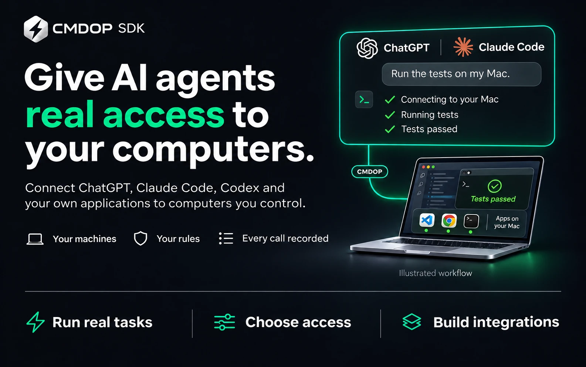

<p align="center">
  <picture>
    <source media="(prefers-color-scheme: dark)" srcset="assets/cmdop-logo-dark.svg">
    
  </picture>
</p>

<h1 align="center">Your AI. Your computers. Connected.</h1>

<p align="center">
Give ChatGPT, Claude Code, Codex and your own applications access to computers you control.<br>
Open an app. Read a file. Run a build. Come back for the result.
</p>

<p align="center">
  <a href="https://docs.cmdop.ai/guides/connect"><strong>Connect your AI</strong></a> ·
  <a href="#build-with-the-sdk">Build with the SDK</a> ·
  <a href="docs/README.md">Read the docs</a> ·
  <a href="https://cmdop.ai">cmdop.ai</a>
</p>

---



*Illustrated workflow: your AI, your applications and a computer you control.*

## Ask here. It happens there.

**“Open Spotify on my Mac.”**

Your AI can act on your computer through CMDOP. An instruction in the chat becomes an action
on the machine you chose, within the access you allow.

Try that scenario with Spotify installed and application control enabled on your Mac.
[Connect your AI](https://docs.cmdop.ai/guides/connect), then ask it to open the app.

## What will you ask your computer to do?

| Ask your AI to… | What happens on your computer |
|---|---|
| “Show me what's in this project.” | It reads the files you allow it to access. |
| “Run the tests and show me the failures.” | It runs your command and reads the output. |
| “Start the build. I'll check it later.” | It starts a persistent task you can revisit. |

Each workflow needs the corresponding access. You choose the computer and the permissions.
Persistent tasks can outlive the call or chat; retained output is bounded and does not survive
a machine-program restart. [Explore the workflows](docs/examples.md).

## Your computers. Your rules.

**Choose the access.** Give each AI client or application its own agent token and permissions.
The computer's access limits and operating system permissions still apply.

**See what happened.** Tool calls are recorded under the agent that made them.

**Disconnect an integration.** Revoke its agent token to prevent its next call.

[Access and authentication](docs/authentication.md)

## Build with the SDK

Use the same computer tools from Python or TypeScript. Start with a read: find an online
computer and print its OS, architecture and CPU count.

| TypeScript / Node.js 20+ | Python 3.10+ |
|---|---|
| `npm install @cmdop/sdk` | `pip install cmdop` |

[Set up your computer and token](docs/quickstart.md), then try a first program.
The SDK connects to CMDOP; install the machine program separately.

<details>
<summary>First read in TypeScript and Python</summary>

These programs use `CMDOP_URL` and `CMDOP_TOKEN` from your environment and need read access.
They choose the first online computer; select an explicit id when the target matters.

**TypeScript**

```ts
import { connect } from "@cmdop/sdk";

const client = connect();
try {
  const online = (await client.machines()).find((machine) => machine.online);
  if (!online) throw new Error("Bring a machine online on your CMDOP page.");
  const info = await client.machine(online.id).sys.info({});
  console.log(info.os, info.arch, info.cpus);
} finally {
  await client.close();
}
```

**Python**

```python
import cmdop

with cmdop.connect() as client:
    online = next((machine for machine in client.machines() if machine["online"]), None)
    if online is None:
        raise RuntimeError("Bring a machine online on your CMDOP page.")
    info = client.machine(online["id"]).sys.info()
    print(info.os, info.arch, info.cpus)
```

[Run the executable examples](examples/README.md) · [Complete quickstart](docs/quickstart.md)

</details>

## Bring the tools you already use

ChatGPT, Claude Code and Codex connections have been verified over MCP. The Python and Node.js
SDKs are published on PyPI and npm. The machine program is available for **macOS and Linux**;
see [feature status](https://docs.cmdop.ai/help/feature-status) for other platforms.

Bring your existing AI account and your computers. CMDOP offers a free core;
see [pricing](https://cmdop.ai/pricing) for current plan terms and limits.

## Go further

[SDK documentation](docs/README.md) · [Workflow showcase](showcase/README.md) · [Examples](docs/examples.md) ·
[TypeScript](docs/typescript.md) · [Python](docs/python.md) ·
[Versions and support](docs/versions-and-support.md) ·
[Releases](https://github.com/commandoperator/cmdop-sdk/releases)

Found a problem or have a useful workflow to share? [Open an issue](https://github.com/commandoperator/cmdop-sdk/issues).
Include a small reproducer for bugs and remove tokens and personal data.
Star the repository if you want to keep these tools handy.

The **SDK is open source under [MIT](LICENSE)**. The rest of the CMDOP platform has its own distribution terms.
Technical documentation here is exported from the public docs site; report corrections through an issue.

[Contribution guide](CONTRIBUTING.md) · [Editorial agent instructions](AGENTS.md)
