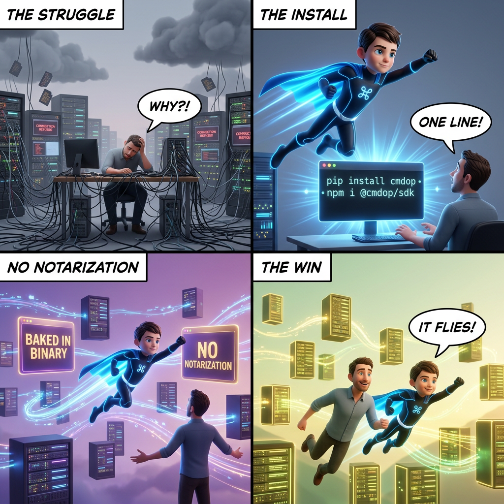
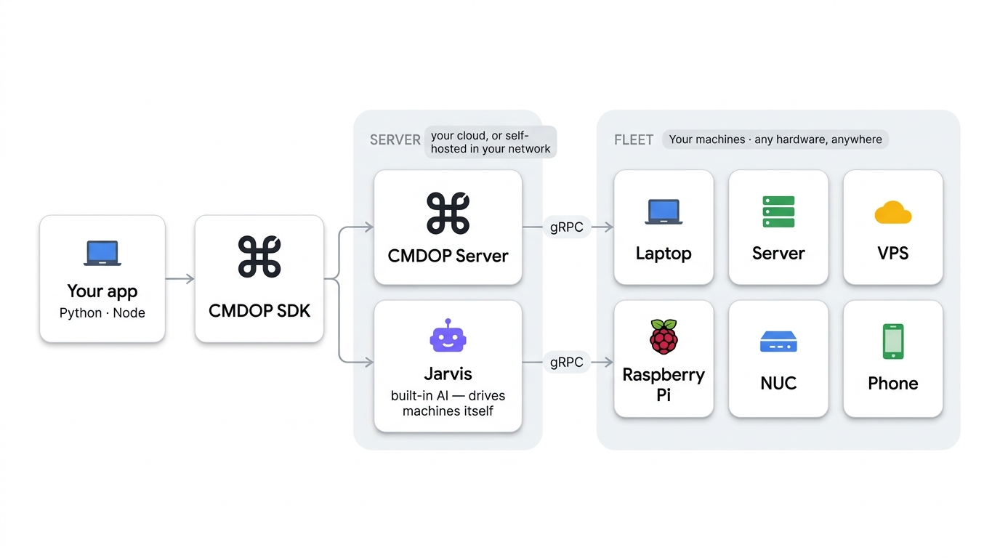

# cmdop — the official SDK for CMDOP



Programmatic access to your CMDOP fleet from **Python** and **Node** — manage
machines, fleets, tunnels, and schedules, stream a machine's AI agent live, and
drive the skills marketplace, all behind one typed client.

CMDOP is a messenger for machines: every machine runs a resident AI agent you can
message. **This repo is the open, MIT-licensed SDK** — typed Python and Node
clients for the platform. The agent + relay ship as a separate, free-to-use
binary. Same model as Telegram: an open client, a hosted service you sign in to.

| | Install | Import |
|---|---|---|
| **Python** | `pip install cmdop` | [`cmdop`](https://pypi.org/project/cmdop/) |
| **Node** | `npm i @cmdop/sdk` | [`@cmdop/sdk`](https://www.npmjs.com/package/@cmdop/sdk) |

Both clients ship in lockstep at the **same version** and expose the **same
surface** — snake_case in Python, camelCase in Node.

📚 **Full documentation: [docs.cmdop.com](https://docs.cmdop.com)** — guides, the
complete API reference, and streaming details. Product pages:
[SDK](https://cmdop.com/sdk) · [Bots](https://cmdop.com/bots) ·
[Connect](https://cmdop.com/connect).

## How it connects



Your app uses the SDK to reach your machines — any hardware, anywhere — through
**your CMDOP relay**. A free [cmdop.com](https://cmdop.com) account provisions your
own isolated relay domain (self-hosting the relay is also supported). The relay
links your fleet over gRPC and hosts the **fleet orchestrator**, a built-in AI
that can drive those machines on its own.

## Why it's easy to adopt

- **One install, zero dependencies.** `pip install cmdop` / `npm i @cmdop/sdk` is
  everything — no native build step, no extra runtime, nothing fetched on first
  run.
- **Runs on macOS, Linux, and Windows.** A single self-contained package;
  nothing is fetched at install or first run. (The CMDOP agent your machines run
  ships for macOS and Linux.)
- **Typed end to end.** Every resource and response is fully typed, with one clean
  async streaming API for live agent output.

## Get your token

The SDK is a client — you need a CMDOP account to point it at.

1. Create a free account at **[cmdop.com](https://cmdop.com)**. It provisions your
   own isolated **relay domain** — that's your `CMDOP_BASE_URL` (e.g.
   `https://<yours>.cmdop.host`). *(Or point at a relay you self-host / a LAN
   address like `http://127.0.0.1:63141`.)*
2. Copy your **`CMDOP_TOKEN`** (relay session token) from the CLI-token page at
   **[my.cmdop.com](https://my.cmdop.com)**.
3. For the `skills` marketplace, also grab a **`CMDOP_API_KEY`** (platform
   `UserAPIKey`) from your account settings at [my.cmdop.com](https://my.cmdop.com).

```bash
export CMDOP_BASE_URL="https://<yours>.cmdop.host"
export CMDOP_TOKEN="cmdop_…"
export CMDOP_API_KEY="…"        # only for skills
```

Then `Client.from_env()` / `Client.fromEnv()` picks these up. `CMDOP_BASE_URL` is
required — there is no default relay host (each account gets its own domain).

## Quick start

```python
# pip install cmdop
from cmdop import Client

async with Client(token="...") as c:                 # or Client.from_env()
    page = await c.machines.list(presence="online")
    text = await c.machines.ask(machine_id, "uptime").collect()
```

```ts
// npm i @cmdop/sdk
import { Client } from "@cmdop/sdk";

const c = new Client({ token: "..." });              // or Client.fromEnv()
const page = await c.machines.list({ presence: "online" });
const text = await c.machines.ask(machineId, "uptime").collect();
await c.close();
```

## What you can do

| Namespace | What |
|---|---|
| `machines` | list / inspect machines, stream their AI agent (`ask`), read & manage conversations |
| `fleets` | create and manage fleets, members, and machine membership |
| `tunnels` | open / close / inspect tunnels |
| `schedules` | create, trigger, and review scheduled jobs |
| `keys` | issue and revoke access keys |
| `skills` | browse, install, publish, and review skills from the marketplace |

The headline feature is **`machines.ask()`** — stream a machine's AI agent as a
clean async iterator of typed events. A connection PIN can be passed **upfront**
(`ask(…, pin="…")`, the headless default) or answered reactively mid-stream, and
dangerous plans surface as inline confirmation prompts.

> **Two planes, one client.** `machines / fleets / tunnels / schedules / keys` use
> your relay token (`CMDOP_TOKEN`); the **`skills`** marketplace uses your platform
> API key (`CMDOP_API_KEY`). Set whichever you need — the client routes each call
> to the right plane.

## Per-package docs

Full method reference, streaming details, environment variables, and error
handling live in each package's README:

- **Python** → [`python/README.md`](python/README.md)
- **Node** → [`node/README.md`](node/README.md)

## Links

- **Docs** → [docs.cmdop.com](https://docs.cmdop.com)
- **SDK** → [cmdop.com/sdk](https://cmdop.com/sdk) · **Bots** →
  [cmdop.com/bots](https://cmdop.com/bots) · **Connect** →
  [cmdop.com/connect](https://cmdop.com/connect)
- [`cmdop` on PyPI](https://pypi.org/project/cmdop/) ·
  [`@cmdop/sdk` on npm](https://www.npmjs.com/package/@cmdop/sdk)
- [CMDOP](https://cmdop.com)

## License

The SDK (this repo) is **MIT** — see [LICENSE](LICENSE). The CMDOP agent/relay
binary and cloud are separate products.
